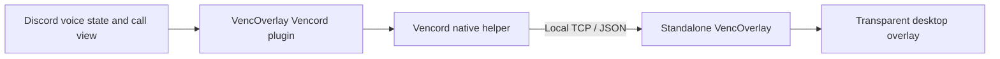

# VencOverlay

A transparent, click-through Discord voice overlay with participant avatars,
speaking indicators, notifications and optional webcam tiles. VencOverlay uses
Vencord to receive call information and runs as a separate desktop application,
so it can display that information over other applications and games.

Based on [Vesktop Overlay](https://github.com/Akii-G/vesktop-overlay), originally
created by [Akii-G](https://github.com/Akii-G). Full credit goes to Akii-G for the
original overlay and its foundation.

**Development preview.** Tested on Fedora 43 x86-64 with GNOME Wayland and
the official Discord Flatpak with Vencord already installed. Other platforms
and installation layouts are not yet validated.

## Installation

### 1. Check the requirements

| Client | Prerequisite | Installer support |
|---|---|---|
| Discord | Install [Vencord](https://vencord.dev/download/) first and confirm it works. | Official stable [Discord Flatpak](https://flathub.org/apps/com.discordapp.Discord), with a compatible existing Vencord installation. |
| Vesktop | No separate Vencord patch is needed; [Vesktop](https://vesktop.dev/) already includes Vencord. | Planned; not supported by this installer yet. |

The current package targets Fedora Linux x86-64. Fedora 43 GNOME Wayland has
been tested on two computers; Fedora 44 and later are not yet verified.
You need Bash, system Python 3.11+, Flatpak, `flock` (util-linux), `ostree` and
compatible GTK3, Cairo, Pango, GdkPixbuf and GLib/GObject libraries. GNOME
Wayland also needs XWayland. The installer checks native runtime compatibility.

**No development tools or compilation are needed for a prebuilt package.**

### 2. Download and extract VencOverlay

Go to [GitHub Releases](https://github.com/caminashell/vencoverlay/releases)
and choose a trusted Fedora x86-64 release asset named
`vencoverlay-<version>-fedora-x86_64.tar.gz`.
Development previews may be listed as pre-releases. Do not download GitHub's
**Source code** ZIP or tarball for a binary installation.

If no installation asset has been published yet, use the
[building from source](#building-from-source) instructions below, or obtain a
trusted matching prebuilt package. Local package generation and installation
have been tested; public availability depends on the release being published.

Compare the downloaded archive's SHA-256 with the publisher's trusted
checksum before extracting it. Extract the archive, open a terminal inside the
extracted directory, and check the packaged files:

```sh
sha256sum --check SHA256SUMS
```

Every listed file should report `OK`. Stop if verification fails. Checksums
detect changes but do not independently authenticate the publisher. Keep the
extracted directory for updates or removal.

### 3. Close Discord

**Completely exit the target application (Discord or Vesktop) before installing,
updating or uninstalling VencOverlay.** Closing its window may leave it running
in the system tray. Also stop any previously running standalone overlay.
Vesktop installation is not implemented yet; the following steps apply to Discord.

### 4. Install VencOverlay

From the extracted package directory (or a built source checkout), run as your
normal desktop user, **not with sudo**:

```sh
./install.sh
```

Review the proposed installation and type `YES` when prompted. The installer
automatically detects the compatible Vencord layout, preserves the original
runtime, installs the custom plugin distribution and creates a desktop launcher
that starts VencOverlay with Discord. Your settings are retained.

If both user and system Discord Flatpak installations exist, select the intended
one with `--scope user` or `--scope system` consistently. Do not use
`--prepare-only` for normal installation.

### 5. Verify the installation

```sh
./install.sh --check
```

Expect `Installation state: Installed`, `Loader: verified existing Vencord`
and `Original _app.asar matches OSTree: True`. The production Vencord baseline
is **1.15.19** (`d086992`); version, plugin, checksum and graphical runtime
checks must pass. Do not bypass a refusal. See [troubleshooting](#troubleshooting)
if any check fails. You can also run this read-only check before installing.

### 6. Enable the plugin and join a voice channel

1. Launch Discord normally from the desktop/application menu.
2. Open **User Settings → Vencord → Plugins**.
3. Find **VencOverlay** and enable it.
4. Join a voice channel. The overlay should appear on the configured monitor.
5. Open the plugin settings to customise its appearance and behaviour.

VencOverlay starts with Discord, hides outside voice calls and shuts down when
Discord exits completely. You do not need to start a separate application or
configure a login-startup service.

## Using VencOverlay


*Illustrative preview with synthetic participants and camera tiles.*

- Choose Discord-style or Mac-style cards, six screen positions, avatar size,
  name visibility, accent colour, scale and opacity in the plugin settings.
- Optionally show only speaking participants, hide yourself, or turn off
  join/leave notifications.
- Webcam tiles are optional and require the Discord call view to be open with
  identifiable camera videos available. Live webcam capture is still unverified.
  Screen/window-share video is not captured; a streaming indicator is supported.
- The overlay is designed to be click-through and non-focusable, so interaction
  remains with the application underneath it. Fullscreen voice-overlay use has
  been tested on Fedora GNOME Wayland.

Most preferences apply immediately. For monitor selection or other local
application settings, see [local configuration](docs/technical-specification.md#local-configuration).

## How it works

VencOverlay consists of two cooperating components. The plugin uses Vencord,
which is installed separately for Discord and bundled with Vesktop. The
following describes the currently implemented Discord integration; Vesktop
installation and live operation still require separate implementation and testing.

- **VencOverlay plugin for Vencord:** runs inside Discord, observes voice-channel
  membership, speaking, mute/deafen and other call state, and sends structured
  updates through Vencord's native helper.
- **Standalone VencOverlay application:** runs outside Discord, receives those
  updates over a local connection (`127.0.0.1:6889` by default), maintains the
  overlay state and draws a transparent GTK3/Cairo window above other applications.



The overlay is hidden when there is no active voice channel. The plugin
reconnects and sends a fresh state snapshot after connection loss. Avatar images
may be downloaded via HTTP(S) and cached locally; webcam frames are processed in
memory. The local connection does not send voice audio and does not require a
remote VencOverlay service. It is not authenticated: other local processes are
within the current trust boundary.

For architecture, message formats, thread ownership, timing, rendering,
installation internals, resource limits and implementation constraints, see the
[full technical specification](docs/technical-specification.md).

## Updating and uninstalling

To update, download and verify the new compatible package from
[GitHub Releases](https://github.com/caminashell/vencoverlay/releases), extract
it into a new directory, completely quit Discord and run `./install.sh` followed
by `./install.sh --check`. The installer automatically detects upgrades and
preserves the original runtime backup and user settings.

The installed custom Vencord distribution disables Vencord's automatic updater
so it cannot replace the plugin; Vencord updates must be delivered through a compatible VencOverlay
build. After a Discord Flatpak update, run preflight again before attempting
repair or upgrade. If a previously adopted installation became incomplete after
Discord was reinstalled or Vencord was reapplied, see
[explicit recovery](docs/flatpak-installation.md#repair-after-discord-or-vencord-reinstallation).
Automatic repatching is not implemented.

To uninstall, fully quit Discord and the overlay, then run from the extracted
package (or a source checkout):

```sh
./uninstall.sh
```

Type `YES` to confirm. For an adopted installation, this restores your original
Vencord runtime and desktop launcher (or removes the managed override if there
was no previous local launcher). It does not uninstall Discord or Vencord or
remove your saved settings and cache.

When removing the managed launcher reveals the original Flatpak desktop entry,
uninstall attempts a timestamp-only refresh of its verified export symlink.
This restored the original Discord icon in live GNOME testing. If the refresh
is not permitted, uninstall still succeeds and prints a warning; the desktop
may need a session refresh. No privilege escalation or extension changes are
attempted.

## Troubleshooting

| Symptom | What to check |
|---|---|
| Missing production artifacts | Use a complete release asset, not a source archive. Alternatively, [build from source](#building-from-source). |
| Installer says Discord is running | Quit from the tray as well as closing the window, then retry. |
| Installation state: Prepared | Quit Discord and run `./install.sh` to complete a compatible prepared installation. See the [installation guide](docs/flatpak-installation.md#prepared-but-not-active). |
| Installation state: Incomplete | Inspect the reason. If Discord was reinstalled or Vencord reapplied, see [controlled repair](docs/flatpak-installation.md#repair-after-discord-or-vencord-reinstallation). Do not delete backups. |
| Discord icon missing after removal | Review the desktop-export refresh warning in the [removal guide](docs/flatpak-installation.md#upgrade-and-removal). Do not modify system-owned launchers or GNOME extensions. |
| Plugin missing or overlay does not start | Verify adoption succeeded, start Discord through the managed desktop entry, and enable the plugin. |
| Overlay not visible in a call | Check plugin enablement, selected monitor and matching local port; avoid starting a second overlay instance. |
| Vencord version or plugin conflict | Do not force replacement; use a compatible distribution and review preflight. |

For other installation layouts, launch failures, backup restoration and safety
checks, see the [detailed Flatpak installation guide](docs/flatpak-installation.md).
Report reproducible problems at [GitHub Issues](https://github.com/caminashell/vencoverlay/issues).

## Compatibility and development status

The prebuilt package has been exercised on two Fedora 43 GNOME Wayland
computers: installation, upgrade, removal/restoration and explicit recovery
following Discord reinstallation and Vencord replacement. The GNOME top-bar
geometry correction and desktop icon refresh were confirmed live. Fullscreen
voice use and input interaction were tested before the geometry correction;
full post-correction regression across scaling and monitor layouts is not yet
established.

Native X11 and compatible GTK Layer Shell backends are implemented, but other
compositors, distributions and clean per-user installation remain unverified
as live installation targets. The frontend archive contains Vesktop bundles,
but Vesktop installation is not implemented. Windows has no graphical backend
yet. Live webcam testing is deferred. Automatic repatching after Discord or
Vencord updates is not implemented.

## Building from source

A Git clone or GitHub source archive does not include the compiled artifacts.
On the Fedora development host, install the prerequisites in the
[development guide](docs/development.md), then from the source root run:

```sh
./setup.sh --frontend \
&& ./validate.sh --frontend \
&& ./build.sh \
&& ./build.sh --frontend \
&& ./build.sh --verify-frontend
```

Validation is recommended; both builds are required. Stop if any command fails.
Then follow [step 3](#3-close-discord) onwards to install from the source root,
or use `./release.sh` to assemble a transferable installation package. The
[release packaging guide](docs/development.md#local-release-packaging) explains
how to verify the archive. Generated binaries and packages are not committed
to Git.

## Documentation and development

| Document | Purpose |
|---|---|
| [Release installation](docs/release-installation.md) | Standalone instructions included in each prebuilt package. |
| [Flatpak installation](docs/flatpak-installation.md) | Detailed compatibility, installation modes, recovery and removal. |
| [Technical specification](docs/technical-specification.md) | End-to-end architecture, contracts and implementation. |
| [Development and builds](docs/development.md) | Build from source, run the demo, validate and maintain the project. |
| [Frontend development](docs/frontend-development.md) | Pinned Vencord toolchain, plugin development and distribution. |

## License and attribution

VencOverlay is a fork and refactoring of the original
[Vesktop Overlay](https://github.com/Akii-G/vesktop-overlay) project by Akii-G.
The original design, rendering implementation and OverlayBridge plugin form the
foundation of this project. The upstream OverlayBridge source credits
`akiloyutu` in its author metadata.

VencOverlay retains the original GNU General Public License v3. See
[LICENSE](LICENSE). The original plugin source carries the `GPL-3.0-or-later`
SPDX identifier. Existing upstream notices and attribution are preserved.
The generated frontend distribution includes
[Vencord](https://github.com/Vendicated/Vencord), its licence and linked legal
notices, project attribution and corresponding source. The inherited bundle and
its original notices remain in Git history. VencOverlay is not affiliated with
Discord or Vencord.
