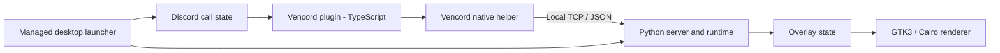

# Engineering case study: VencOverlay

**Milestone:** First development preview, `0.1.0.dev1`  
**Completed:** 26 November 2026  
**Role:** Project maintainer and learner  
**Release:** [v0.1.0.dev1](https://github.com/caminashell/vencoverlay/releases/tag/v0.1.0.dev1)

## 1. Executive summary

VencOverlay is an educational open-source software engineering project based on
[Akii-G's Vesktop Overlay](https://github.com/Akii-G/vesktop-overlay). It displays
Discord voice-call information in a transparent desktop overlay, allowing users
to see participants and speaking activity while using other applications or games.

The objective of the first milestone was not to invent an overlay from scratch,
but to take an existing working application and develop a more maintainable,
testable and distributable foundation for future cross-platform development.
This provided a practical setting for learning Python, software architecture,
project management, quality assurance, dependency management, deployment and
release engineering.

The milestone concluded with a published, checksum-verified development preview
built from a clean `main` commit. The supported baseline is deliberately narrow:
Fedora 43 x86-64, GNOME Wayland and Discord Stable Flatpak with a compatible
existing Vencord installation. Broader compatibility is future work, not an
achievement claimed by this release.

| Outcome | Recorded result |
|---|---|
| Python tests | 271 passed |
| Application source coverage | 95% (reported rounded coverage) |
| Renderer statement coverage | 100% |
| Selected validation gates | 7/7 passed |
| Candidate runtime acceptance | 12/12 passed |
| Final distribution smoke test | 6/6 passed |
| Third-party source archives | 26 |
| Supplemental licence/notice entries | 19 |
| Published custom release assets | 3, downloaded and verified |

These results describe the first release milestone, not continuously updated
metrics or proof of defect-free operation.

## 2. Starting point and requirements

The project inherited an existing overlay and Vencord-compatible plugin design.
The original implementation, rendering work and OverlayBridge plugin are
credited to their upstream authors; the refactor builds on that foundation.

The initial practical requirements were to make the overlay work with Discord
Flatpak rather than depend on a Vesktop-specific launch workflow, retain the
existing user experience, and ensure the overlay starts only with Discord and
terminates when Discord exits. A desktop panel visibility problem on GNOME
Wayland also became an important live acceptance requirement.

The scope expanded to include explicit version management, a modular Python
application, a maintained TypeScript plugin, reproducible validation procedures,
a standalone executable, installation lifecycle tooling, documentation and
release evidence. Readable maintained source was retained while distributed
frontend JavaScript and CSS were built in production mode with minification.

The project prioritised a working Fedora baseline before attempting additional
Linux distributions or native Windows and macOS backends. This reduced the
number of simultaneous unknowns and made it possible to validate a real end-user
package early in the project.

## 3. Architecture and engineering decisions



The design separates client-specific voice-state collection from desktop
presentation. The Vencord plugin observes call state and sends structured
messages through a native helper. A separate Python application receives those
messages, manages presentation state and draws the overlay. The overlay does
not inject rendering code into games or require a remote overlay service.

| Decision | Rationale and trade-off |
|---|---|
| Separate plugin and native host | Isolates Discord-specific state collection from rendering and permits backend evolution, at the cost of an explicit protocol and connection lifecycle. |
| Typed, validated JSON messages over loopback TCP | Provides a clear, independently testable integration boundary. The local listener is not authenticated; other local processes remain within the trust boundary. |
| GUI-thread ownership with bounded queues and image resources | Keeps graphical operations on the appropriate thread and limits accumulation of stale work. This adds concurrency and lifecycle considerations that require tests. |
| GTK3, Cairo and Pango on Linux | Retains the existing graphical technology and supports a practical initial implementation. Compositor differences and native ABI compatibility limit portability. |
| Nuitka onefile host executable | Removes the need for users to set up the development Python environment. Native dependencies, compatibility checks and corresponding-source obligations remain relevant. |
| Pinned Vencord and minified production builds | Makes the frontend version and build inputs explicit. Automatic upstream runtime replacement is disabled in the managed distribution, so maintenance updates must be delivered deliberately. |
| Managed launcher and reversible Vencord adoption | Starts the overlay with the client, preserves original runtime material and supports repair/removal. Installation must refuse ambiguous or incompatible layouts. |

See the [technical specification](technical-specification.md) for the detailed
protocol, module responsibilities, backend selection, rendering and trust model.

## 4. Project organisation and delivery

The work was organised into incremental implementation and release milestones,
with validation between changes instead of postponing testing until the end.
The release preparation phase explicitly separated packaging, installation
acceptance, redistribution review, integration into `main`, final asset
verification and publication.

| Phase | Deliverable or exit criterion |
|---|---|
| Refactor and integration (including A4 and R1–R5) | Maintainable native and frontend components, working integration, validated installation and supporting documentation. |
| R6.1–R6.4 | Build and release packaging, dependency evidence, archive verification and rebuild procedures. |
| R6.5 | Candidate installation and live acceptance. |
| R6.6 | Technical redistribution review, source corrections and maintainer approval. |
| R6.7 | Fast-forward integration of the refactor into `main`, preserving history. |
| R6.8–R6.9 | Full validation, clean production build, checksum and archive checks, and final installed-runtime smoke test. |
| R7 | Annotated release tag, GitHub pre-release, download verification and completed branch cleanup. |

Development used a dedicated refactor branch. Once the review was approved,
the branch was fast-forwarded into `main`. Publication assets were regenerated
from the final clean commit, not merely renamed or reused from an earlier
candidate. The release tag was created only after the final package passed
acceptance. The merged feature branch was removed after publication checks.

## 5. Selected engineering challenges

### 5.1 GNOME top bar disappeared when the overlay was active

**Problem.** The overlay worked over applications, but GNOME's top bar could
become hidden while it was running. This conflicted with the requirement that
the desktop remain usable and the overlay not interfere with the environment.

**Investigation and decision.** The documented cause was Mutter's fullscreen
classification of an override-redirect window matching the monitor rectangle,
even without an explicit fullscreen state. The GNOME-specific geometry path was
adjusted to reduce both dimensions by two logical pixels while retaining the
monitor origin. Other backends retained their sizing and the click-through
behaviour was not changed.

**Evidence.** The correction restored the top bar during live Fedora testing.
The final acceptance confirmed top-bar visibility and fullscreen voice-overlay
operation. Other scaling and monitor arrangements remain to be validated.

**Lesson.** Passing rendering tests does not establish correct compositor
behaviour. A small platform-specific correction with a clearly defined boundary
can be preferable to a broad, unverified change to the graphics architecture.

### 5.2 Installation ownership, restoration and recovery

**Problem.** Existing Discord Flatpak and Vencord installations could have
layouts and settings that should not be overwritten blindly. Client updates or
reinstallation could also invalidate the assumptions of a previous installation.
In live testing, the original desktop icon could intermittently fail to reappear
after removal despite the original desktop export remaining intact.

**Decision.** The installer verifies the selected scope, native runtime,
frontend archive, existing Vencord revision and client layout before making
changes. It retains the original Vencord runtime backup, preserves settings,
provides explicit repair and removal paths, and uses a managed launcher with a
shared lock. A desktop-export timestamp refresh was added to address the
observed launcher restoration issue, on a best-effort basis when permissions
allow it.

**Evidence.** Installation, upgrade, restoration and repair were exercised in
live Fedora tests. The final distribution successfully adopted an existing
Vencord installation. Its post-installation check reported the expected managed
version, a verified loader and original `_app.asar` matching OSTree. In the final
runtime test the host listened on `127.0.0.1:6889` during a voice session, and no
listener remained on that port after Discord exited.

**Lesson.** Deployment is a state-management problem, not simply copying files.
Ownership, preflight checks, recovery and preservation of existing settings
matter as much as the successful first installation. These safeguards do not
constitute a crash-proof transactional installer.

### 5.3 Native compilation and dependency modification

**Problem.** A compiled onefile application still has native runtime
requirements. Compiler discovery must select the intended GTK3 namespaces, and
bundled libraries need suitable source and rebuild procedures.

**Decision.** The build uses a version-pinned Nuitka GI discovery adjustment,
checks the packaged GTK3 typelibs and required standard-library accelerators,
and records native build metadata and dependency evidence. The installer
performs an unmapped-window runtime compatibility probe before normal use.

**Evidence.** An isolated rebuild using modified PyGObject 3.58.1 and Pycairo
1.29.2 C extensions produced both diagnostic markers in the resulting executable
and passed the native runtime check. The final publication build used the normal
reviewed dependencies, not those diagnostic modifications. Nuitka still emitted
a non-fatal `gi.repository` patch warning; compilation, package checks and live
runtime acceptance succeeded. Individual Fedora source RPM rebuilds were not
performed as part of that experiment.

**Lesson.** A successful compiler exit is only one release gate. Evidence must
cover the actual binary, native compatibility and the ability to rebuild
relevant modified dependencies. See the [development guide](development.md).

### 5.4 Published package metadata did not identify the matching source

**Problem.** The redistribution review found that the published npm archives for
`@vap/core` and `fflate` did not contain their editable TypeScript
implementations. Adding the upstream source trees revealed a further discrepancy:
`@vap/core` 0.0.12's npm `gitHead` referred to a tree declaring version 0.0.11
and lacking the published worker-options implementation.

**Investigation.** Git history identified the successor commit
[`264a6b4`](https://github.com/Vap0r1ze/vapcord/commit/264a6b4f8f88f3bfaa892de4a8b6c2745976039e),
which introduced both the missing implementation and the version change.
The six implementation files were transpiled and compared with the JavaScript
in the published package. All six matched byte for byte. The comparison used a
newer TypeScript compiler than upstream and emitted output despite a diagnostic;
it was an implementation-output equivalence check, not a clean reproduction of
the upstream build.

**Decision.** The source collector was updated to pin the matching upstream
commit and preserve the original npm metadata for provenance. `fflate` 0.8.3
was pinned to the peeled commit of its upstream version tag; its npm build was
not independently reproduced. Both original npm packages were retained alongside
the full upstream source trees, original notices and manifest checksums.

**Evidence.** The final source archive included 26 dependency archives and 19
supplemental notices. The source collection and verification passed, and the
final project validation and maintainer review were completed before publication.
This was a technical redistribution review, not formal legal certification.
See [third-party notices and corresponding source](licences/third-party-source.md).

**Lesson.** Dependency names, versions and registry metadata are useful evidence,
but they do not alone establish the source corresponding to shipped code.
Checking implementation content and preserving the reason for a corrected pin
made the release evidence more defensible than relying on metadata alone.

## 6. Quality assurance and acceptance

The final full validation command was:

```sh
./validate.sh --frontend --graphical --coverage
```

All seven selected validation gates passed: shell syntax, Ruff linting, Ruff
formatting, strict Basedpyright, Pytest, Vencord TypeScript and Vencord Oxlint.
The Python suite reported 271 passing tests and zero type-checking diagnostics.
Coverage reported 1,659 application statements, of which 83 were missed (95%
rounded). The renderer reported 502 statements and zero missed. These figures
refer to the application-source coverage report, not total repository coverage
or coverage of the TypeScript plugin and release scripts.

Automated checks cover areas including protocol validation, connection and
runtime behaviour, state transitions, image decoding and caching, rendering,
window behaviour, build artifacts, installer and source-collection tooling.
Live graphical tests complement automated tests because compositor behaviour,
actual Discord integration and installation state cannot be established solely
by mocked or synthetic tests. The offline demo is also useful for exercising
rendering without a Discord account or live call.

The candidate passed twelve reported live acceptance checks covering launch,
voice-channel behaviour, settings, desktop/fullscreen integration, shutdown,
relaunch and duplicate-instance prevention. The final rebuilt distribution
passed six targeted smoke checks, including installation and client-linked
startup/shutdown. The socket observation supplied additional evidence of
loopback binding and listener cleanup, rather than proof of all process or
security properties.

## 7. Release and distribution evidence

The release was built from commit
[`41c6b6c`](https://github.com/caminashell/vencoverlay/commit/41c6b6c626c801e4cc1fe2f8d456b99845778038)
and tagged `v0.1.0.dev1`. The package manifest records a clean source tree,
Fedora 43 x86-64 and Vencord 1.15.19 at revision
`d086992fb674299a2fa05ac6432edc3a777389f3`.

The installation archive contains the compiled host, production frontend,
installer, project source and build-specific licence evidence. A companion
archive provides the collected third-party sources and supplemental notices.
The final three release assets are:

- `vencoverlay-0.1.0.dev1-fedora-x86_64.tar.gz`
- `vencoverlay-0.1.0.dev1-third-party-source.tar.gz`
- `SHA256SUMS`

After publication, all three were downloaded from GitHub into an isolated
temporary directory. Both archive hashes matched the reviewed baseline:

```text
8c6a9503c5327525c4b9141cf07cddb0fb27e96f769dbce93e35a23e2ad40cea  vencoverlay-0.1.0.dev1-fedora-x86_64.tar.gz
bca7d72db304e747ce4d6a97e2985e9ba20d0f5bc213e7a4953227baf31e485f  vencoverlay-0.1.0.dev1-third-party-source.tar.gz
```

This establishes consistency between the reviewed and downloaded assets.
Checksums do not independently authenticate the publisher; neither the tag nor
the assets were cryptographically signed. The release is a development preview,
not a declaration of general production readiness. A repeatable build procedure
and verified artifact provenance should not be confused with a demonstrated
bit-for-bit reproducible build across independent environments.

## 8. Limitations and next steps

The first milestone deliberately leaves several areas open:

- Additional Linux distribution, client installation and desktop compatibility,
  followed by Windows 11 and lower-priority macOS support.
- Live webcam validation; feasibility of replacing webcam tiles with stream
  thumbnails remains to be established.
- Wider graphics regression coverage, particularly scaling, multiple monitors
  and alternate compositors.
- Local protocol authentication, stronger artifact authenticity and additional
  recovery/installation scenarios, where appropriate after risk assessment.
- Automated cross-platform continuous integration and release workflows as the
  supported matrix expands.

The [project roadmap](roadmap.md) tracks planned features and platform scope.
Discord client modifications also present an external policy risk; the
[project disclaimer](../README.md#project-purpose-and-disclaimer) describes the
educational purpose and limitations of the project. Technical compatibility
and open-source licensing do not grant authorisation from Discord.

## 9. Reflection and attribution

The most useful outcome of this project is a validated engineering baseline,
rather than just a larger feature set. A narrow support claim, explicit
acceptance criteria, reversible deployment and documented dependency provenance
made it possible to decide when the first milestone was ready to publish.

There is still room to improve the process. Earlier automation of artifact
comparison and platform checks could reduce repeated manual review. Recording
engineering decisions and test evidence as they occur would make future
retrospectives easier. Additional compatibility should be delivered incrementally
rather than assuming that an existing Linux or Windows implementation will work
unchanged on every installation method.

This case study describes the maintained fork and the development process, not
sole authorship of its code. Akii-G's original Vesktop Overlay, the upstream
OverlayBridge author credit (`akiloyutu`), Vencord contributors and third-party
components remain attributed in the repository and distribution. AI assistance
was used in the collaborative development process, including planning, code and
test drafting, review, troubleshooting and documentation. The maintainer set
requirements, reviewed decisions, ran local builds and tests, confirmed live
acceptance, approved redistribution and published the release. The case study
should not be read as a claim that all implementation was written unaided.

### Evidence and further reading

- [Tagged source and commit history](https://github.com/caminashell/vencoverlay/tree/v0.1.0.dev1)
- [Published release and checksums](https://github.com/caminashell/vencoverlay/releases/tag/v0.1.0.dev1)
- [Technical specification](technical-specification.md)
- [Development and builds](development.md)
- [Frontend development](frontend-development.md)
- [Flatpak installation and recovery](flatpak-installation.md)
- [Third-party source and notices](licences/third-party-source.md)
- [Future roadmap](roadmap.md)

The retrospective uses the tagged implementation, packaged manifests, project
documentation and recorded maintainer validation, installation and publication
outputs. Some detailed milestone figures in the tagged technical specification
predate the final validation; the final test results above supersede those
historical figures for this case study. Live-test results are maintainer-reported,
not a third-party certification. This is a historical snapshot of the first
release, not a live compatibility matrix or a substitute for installation guides.
