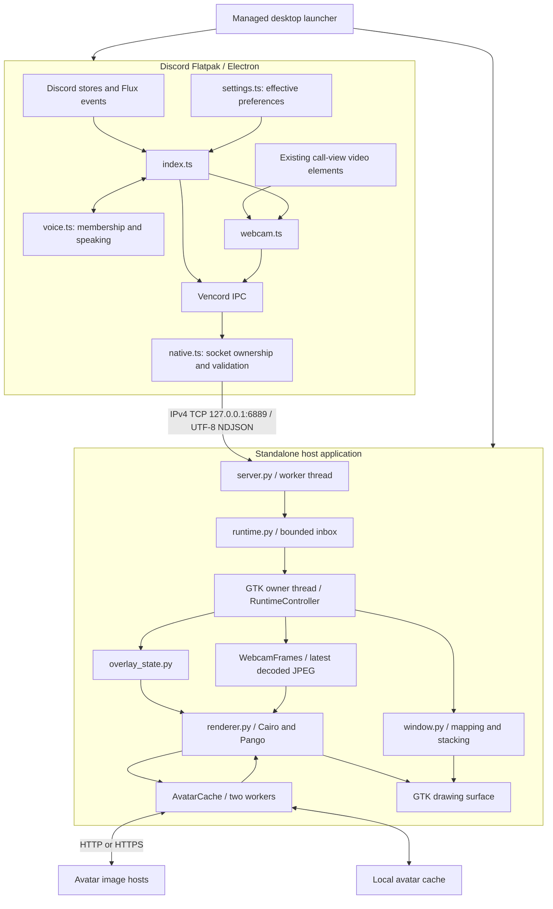
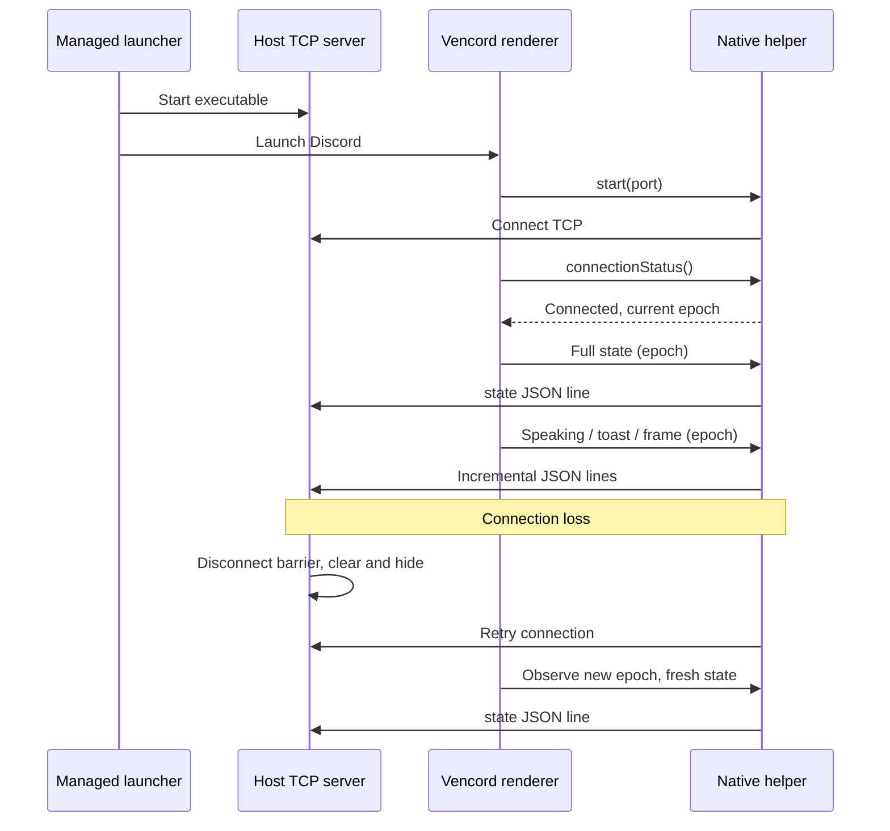

# VencOverlay technical specification

**Implementation baseline:** VencOverlay `0.1.0.dev1` development candidate,
pinned Vencord `1.15.19` (`d086992fb674299a2fa05ac6432edc3a777389f3`),
final A4 implementation, GNOME Wayland geometry correction and R1–R6 release
engineering changes. This describes the implemented system,
not a proposed future architecture. Live validation limitations are recorded
in [section 12](#12-validation-and-known-limitations).

For ordinary use, see the [installation steps](../README.md#installation).
For commands and tooling, see [development](development.md),
[frontend development](frontend-development.md) and
[Flatpak installation](flatpak-installation.md).

## 1. Purpose and system boundaries

VencOverlay displays Discord voice-call information above desktop applications
and games without injecting drawing code into those applications. It is split
into a Vencord plugin inside Discord and a standalone native graphical process
on the host. The plugin is the source of call state; the desktop application is
responsible for rendering it. No Discord bot, remote overlay server, game API,
Discord credentials or audio capture is required. The application does not
modify the underlying game's process or render pipeline.

The maintained runtime is Linux GTK3/Cairo/Pango using Python 3.13+ source and
PyGObject bindings. The plugin is TypeScript compiled as part of Vencord's
Electron renderer and native/main-process bundles. The shipping Linux host
executable uses Nuitka onefile. A separate verified archive supplies the custom
Vencord distribution. Windows path handling exists, but the graphical backend
currently rejects non-Linux platforms.

## 2. Architecture and component relationships



The native helper uses Vencord's renderer-to-main IPC interface; the network
connection is between the Electron native helper and Python server, not a web
server. The native helper validates outgoing messages before sending. The
Python server validates incoming messages independently. It does not send state
acknowledgements to the plugin. The GUI thread owns presentation state and
native window operations; transport callbacks only enqueue work. Avatar workers
fetch/decode images asynchronously and publish completed results on the owner
thread.

### Source ownership

| Source | Responsibility |
|---|---|
| `plugin/vencoverlay/index.ts` | Plugin lifecycle, Discord store access, Flux subscriptions, synchronisation, avatar URL normalisation and IPC coordination |
| `plugin/vencoverlay/voice.ts` | Authoritative membership snapshots, speaking, session/revision counters and membership notifications |
| `plugin/vencoverlay/settings.ts` | Settings definitions, migration, effective values and change callbacks |
| `plugin/vencoverlay/webcam.ts` | Identified camera discovery, bounded capture and asynchronous JPEG encoding |
| `plugin/vencoverlay/protocol.ts` | TypeScript wire types, bounds, normalisation and validation |
| `plugin/vencoverlay/native.ts` | Electron IPC, socket lifetime, connection epochs, retry, validation and backpressure |
| `src/vencoverlay/cli.py`, `application.py` | CLI, configuration, logging and runtime boundary |
| `src/vencoverlay/paths.py`, `config.py`, `logging_setup.py` | Platform paths, immutable TOML configuration and logging resources |
| `src/vencoverlay/backend.py`, `window.py` | Backend selection, native window lifecycle, geometry, mapping and input shape |
| `src/vencoverlay/protocol.py`, `server.py` | Typed messages, parsing, framing and loopback transport |
| `src/vencoverlay/runtime.py` | GTK main loop, inbox, dispatch, signals and resource ownership |
| `src/vencoverlay/overlay_state.py` | Current channel, participants, animations and toasts |
| `src/vencoverlay/renderer.py` | Visual layout, drawing, styles and image presentation |
| `src/vencoverlay/image_cache.py`, `image_decode.py` | Bounded avatar retrieval, PNG/JPEG checks, GdkPixbuf decoding and frame storage |
| `src/vencoverlay/demo.py` | Synthetic, offline runtime feed and generated images |
| `scripts/flatpak_install.py`, `discord-with-overlay.sh` | Deployment, integrity checks, ownership and launcher supervision |
| `build.sh`, `scripts/frontend.sh`, `scripts/frontend-build.mjs`, `scripts/frontend_artifacts.py` | Standalone and custom frontend builds, artifact verification |

## 3. Runtime lifecycle and connection recovery

### 3.1 Launch and shutdown

The managed per-user desktop entry wraps the exported Discord Flatpak command.
The launcher uses a shared `flock` lock in `$XDG_RUNTIME_DIR/vencoverlay-discord.lock`
to coordinate with installation and prevent overlapping managed launches. If
Discord was started independently, it forwards the launch without taking over
that process. Otherwise it starts the standalone executable, launches Discord
with preserved URI/file-forwarding arguments, waits for the foreground Flatpak
command to exit and terminates its own overlay child. It does not implement an
overlay crash-restart supervisor or automatic login startup.

The host reads configuration and initialises logging, selects its backend before
initialising GTK, pins drawing namespaces, and constructs the window (initially
unmapped), image services, state, renderer and runtime controller. Normal mode
starts the loopback listener; demo mode uses synthetic messages instead.
`SIGINT` and `SIGTERM` request GTK loop shutdown. `SIGUSR1` toggles visibility
without terminating the process. Cleanup removes timers/signal sources, joins
the server worker, destroys the surface and closes image resources. Runtime
callback failures are logged and cause nonzero exit rather than silent partial
operation. Closing Discord to the tray does not end the foreground process.

### 3.2 Plugin lifecycle and reconnect

Enabling the plugin initialises voice state and capture generation, exposes
`VencOverlayDebug()`, requests a native connection, and starts state and camera
timers. Disabling it cancels these timers, clears membership and camera state,
removes diagnostics and disconnects the native helper. The host then clears its
state and hides the window; the launcher-owned process can remain alive until
Discord exits. Re-enabling does not require restarting the host.



| Mechanism | Value / rule |
|---|---|
| Socket reconnect | Retry after 2,000 ms; connect timeout 5,000 ms |
| Renderer status polling | 250 ms |
| Full state heartbeat | 2,000 ms, in addition to dirty state and new connections |
| State coalescing | 30 ms |
| Socket ownership | One active native connection; epoch invalidates stale sends and callbacks |
| Resynchronisation | Full state must be successfully queued before incremental messages are accepted for the epoch |
| Port change | Cancel old connection; reconnect to new configured port; host port must already match |

A successful native write means local acceptance/queueing, not confirmation that
the host processed or rendered the message. The connection epoch is an IPC-side
guard, not a wire field. A server disconnect inserts a barrier in the host
inbox, clearing state and latest frames. Stale work is discarded on channel,
membership or relevant settings transitions. The next full state recovers the
current call without reconstructing missed transient notifications.

## 4. Discord voice data and presentation preferences

The plugin reads the selected voice channel and corresponding Discord voice
state records, user/guild member metadata and local account identity. Flux
handlers respond to `VOICE_STATE_UPDATES`, `VOICE_CHANNEL_SELECT`,
`RTC_CONNECTION_STATE`, `SPEAKING`, `USER_UPDATE` and `GUILD_MEMBER_UPDATE`.
The selected channel alone is insufficient: the local user must also be present
in the observed voice membership. Incomplete or unavailable state is not treated
as evidence of another participant joining or leaving. `VoiceTracker` retains
one authoritative map; membership changes are compared only between complete
snapshots within the same channel. Initial entry and store recovery establish
baselines, not artificial join/leave events. Speaking is limited to current
members, cleared on removal/channel change, and rejects a mismatched channel
ID when the event supplies one. Channel-less speaking events cannot independently
prove their originating channel.

State snapshots carry the channel and the ordered visible participant list
(local user first, then alphabetical names), plus shared preferences. Mute
combines server/self mute and suppression; deafen combines server/self deafen;
`serverMuted` represents server mute or server deafen. `video` and `live`
represent camera/stream state, subject to presentation settings for video.
Metadata lookups fall back safely when optional stores are missing. Recognised
Discord CDN avatar URLs are normalised to static PNG at size 128; this avoids
WebP returned by Discord despite a requested PNG format.

### Plugin settings contract

| Saved key | Default | Allowed values / effect |
|---|---|---|
| `style` | `discord` | `discord`, `mac` |
| `showNames` | `always` | `always`, `speaking`, `never` |
| `avatarSize` | `large` | `large`, `small` |
| `position` | `top-left` | Four corners plus `middle-left`, `middle-right` |
| `scale` | 1 | 0.6–1.8 |
| `opacity` | 0.85 | 0.3–1 |
| `accentColor` | `#23a55a` | Six hex digits, optional `#`; wire name `accent` |
| `showOnlySpeaking` | false | Boolean; wire name `onlySpeaking` |
| `showSelf` | true | Include local participant |
| `showWebcams` | true | Show available camera tiles |
| `showOwnWebcam` | true | Include own camera when enabled and self is shown |
| `webcamFps` | 15 | 5, 10, 15, 20, 24 or 30 |
| `webcamWidth` | 280 | 160–480 pixels before overlay scaling; UI uses discrete markers |
| `toasts` | true | Enable other-participant join/leave notifications |
| `port` | 6889 | Integer 1–65535; decimal string accepted by normaliser |

Appearance changes publish new state. Webcam eligibility, visibility and tile
width invalidate capture and require fresh state; FPS changes replace the timer.
Port/FPS and local filters are not transmitted as shared appearance settings.
Invalid saved values use effective defaults without rewriting the stored profile.
`migratePluginSettings("VencOverlay", "OverlayBridge")` preserves original
settings if the new entry is absent; the new entry takes precedence. This call
is tested, but live migration from the original profile is unverified.

## 5. Wire protocol

Transport is a single TCP byte stream on IPv4 `127.0.0.1`, configurable port
(default 6889), one active accepted client at a time. Each message is a UTF-8
JSON object followed by LF (`\n`); TCP chunk boundaries have no message meaning.
Maximum JSON payload is 8 MiB excluding the newline. There is no version field,
handshake, authentication, encryption or server acknowledgement. Keep both
components from compatible builds. The native side uses strict type/field
validation; the Python parser independently checks required values, duplicate
participant IDs and bounds, and is not an identical exact-key validator.

### 5.1 Message types

| `t` | Fields besides `t` | Meaning |
|---|---|---|
| `state` | `channel`, `users`, `config` | Full authoritative presentation snapshot; null channel means inactive |
| `speaking` | `id` (string), `on` (boolean) | Change speaking state for a known participant |
| `toast` | `kind` (`join`/`leave`), `text` (string), `avatar` (string/null) | Transient membership notification |
| `frame` | `id` (string), `w`, `h` (integers), `data` (Base64 JPEG) | Latest camera image for a known video participant |

`channel` is null or `{id: string, name: string, guild: string|null, icon: string|null}`.
Each member of `users` has string `id`, string `name`, nullable string `avatar`,
and boolean `me`, `speaking`, `mute`, `deaf`, `serverMuted`, `video`, `live`.
IDs must be unique within a snapshot. `config` contains the ten shared
preferences `position`, `scale`, `opacity`, `accent`, `style`, `showNames`,
`avatarSize`, `onlySpeaking`, `showWebcams`, `webcamWidth`, with the ranges in
section 4. Python supplies its own defaults for omitted preference keys;
the initial overlay state uses `#30d158`, while omitted wire preferences
and normal plugin state use `#23a55a` unless customised. Normal native messages
include all required fields.

Example inactive snapshot (one JSON line, followed by LF):

```json
{"t":"state","channel":null,"users":[],"config":{"position":"top-left","scale":1,"opacity":0.85,"accent":"#23a55a","style":"discord","showNames":"always","avatarSize":"large","onlySpeaking":false,"showWebcams":true,"webcamWidth":280}}
```

Example incremental messages (each is independently terminated by LF):

```jsonl
{"t":"speaking","id":"1001","on":true}
{"t":"toast","kind":"join","text":"Participant joined","avatar":null}
```

An incremental event alone does not establish an active channel. `frame.data`
is Base64 of the actual JPEG bytes, not a data URI. Maximum decoded JPEG is
2 MiB, width 1–960, height 1–1920. The image header dimensions must equal
`w` and `h`; the image decoder additionally checks content and limits.

### 5.2 Flow control and failure semantics

Native writes enforce projected buffered size: frames are expendable above
4 MiB; controls may use up to 8 MiB plus LF. A control overflow resets the
connection rather than silently dropping state transitions. Frames are checked
for capacity before capture and again at the final write. The Python server
reads chunks of up to 65,536 bytes with a 200 ms socket timeout, reassembles LF
messages, ignores malformed messages, and closes the connection on an oversized
line. A subsequent client can connect. Neither side queues unlimited frames.

## 6. Host dispatch, state and rendering

`CommunicationServer` owns its listener and worker thread. `MessageInbox`
uses a lock to transfer events to the GTK thread, with a disconnect barrier,
32 pending controls, 8 pending latest-per-user frames, at most 32 events per
GUI tick and at most 2 frame decodes per tick. The frame limit can defer later
queued controls to the next tick to preserve order. On control overload pending
state is discarded and incremental messages are withheld until a new full
snapshot. Channel changes discard queued frames. The runtime checks current
participant/video eligibility before accepting decoded frames.

`RuntimeController` applies control events to `OverlayState`, prunes or clears
frames as membership changes, advances animations, polls avatars, synchronises
window visibility and requests redraw only when visible and needed. GTK's
main loop is the sole presentation owner. A full state replaces membership and
preferences; same-channel retained members keep animation state. Disconnect and
null channel clear people, order and notifications. Channel transitions clear
prior channel data before applying the new snapshot. A manual visibility toggle
is independent of current call state.

| Timing | Value |
|---|---|
| Animation/dispatch timer | 16 ms (nominal, not a guaranteed frame rate) |
| Maximum animation delta | 100 ms, monotonic time |
| Speaking-only visibility hold | 1.5 s |
| Glow easing | Activation speed 14; decay speed 5 |
| Participant alpha easing | Speed 8 |
| Toast lifetime/capacity | 4.5 s; newest 3 |
| Stacking maintenance | 500 ms; raise only while mapped |

Cairo clears the surface to transparency and draws participant blocks, avatars
or initials, speaking glows, mute/deafen and camera/live indicators, webcam
tiles and toasts. Pango/PangoCairo handle text layout. Geometry uses the actual
GTK allocation, configured margin and scale, and selected position. Webcam
images retain aspect-ratio-aware presentation, with centre cropping where
needed; missing images render placeholders. Both visual styles use shared
state and image lookups. Mac-style names use normal font weight and interpolate
opacity from 50% when silent to 100% when speaking, multiplied by participant
fade. The renderer does not control membership, transport or the window lifecycle.

## 7. Graphical backends and window management

| Environment | Automatic selection |
|---|---|
| Linux X11 or unspecified session | X11 |
| GNOME Wayland | XWayland (`GDK_BACKEND=x11`) |
| Other Wayland with GTK Layer Shell typelib | Layer Shell (`GDK_BACKEND=wayland`); compositor support verified when creating the surface |
| Other Wayland without typelib | XWayland fallback |
| Non-Linux | Backend error (not implemented) |

`VENCOVERLAY_BACKEND=auto|x11|layershell` is optional. Explicit Layer Shell
requires non-GNOME Wayland and available typelib; incompatible requests fail
rather than silently changing behaviour. A composited RGBA visual is mandatory.

The X11 surface is a GTK popup, notification-type hint, undecorated, keep-above,
skipped by taskbar/pager and non-focusable. Its native window uses override
redirect and an empty input shape to pass clicks through. The Layer Shell surface
is a GTK toplevel in the overlay layer, anchored on four edges with exclusive
zone -1 and keyboard mode NONE. The app refits to its selected monitor on display
changes, clamps an out-of-range monitor index and falls back to primary monitor
if lookup fails. Click-through is reapplied on realise and allocation. Mapping
occurs only with active voice state and enabled manual visibility; otherwise the
window is hidden, not a full-monitor invisible input surface.

### GNOME fullscreen classification correction

Mutter can classify an override-redirect window matching a monitor's rectangle
as fullscreen even without `_NET_WM_STATE_FULLSCREEN`. GNOME then hides its top
bar. The GNOME Wayland selection (including explicit X11 override) sets
`avoid_monitor_sized_window`; `GtkWindowSurface.refit()` keeps the monitor
origin and reduces both dimensions by two logical pixels (minimum 1).
For a 2560 × 1440 monitor at 100% scaling this yields 2558 × 1438. Other backends
retain their existing sizing. Native properties and click-through are unchanged.
This correction restored the top bar on the second Fedora machine with an
active overlay. Fullscreen and scaling regression coverage remains limited;
this is not a claim that all compositor/window arrangements are validated.

## 8. Image acquisition and bounded resources

### 8.1 Avatars

The plugin sends URL metadata, not downloaded avatar bytes. The host requests
HTTP(S) avatar images asynchronously, with a 10-second request timeout and
512 KiB response cap. Only valid PNG images up to 256 × 256 are accepted;
GdkPixbuf decodes with maximum output dimension 128. Two workers handle at most
16 pending requests. The memory cache holds up to 128 entries (LRU ordering),
with 24-hour successful freshness and 30-second failure retry. Persistent cache
files use SHA-256 of the URL as filename (`<hex>.image`), contain original image
bytes, and are atomically replaced. Disk cleanup retains regular matching files
only, expires entries after 24 hours and evicts oldest entries to a 64 MiB
budget. Unrelated files are not managed and symbolic links are not accepted as
cache entries. A failure yields initials/placeholder, not a blocked UI.

### 8.2 Webcam frames

Camera capture is entirely plugin-side. It uses existing playable HTML video
elements in the Discord call view, requiring an explicit participant match via
`data-selenium-video-tile`. Identifiers containing `:` (stream keys), unknown
participants and unready/detached videos are excluded. Where duplicated, the
ready video with the greatest source width wins. Discovery is cached for up to
500 ms; media source, element identity and eligibility are rechecked before
reuse and after asynchronous encoding. The plugin does not start camera or
screen-share subscriptions or capture arbitrary desktop pixels.

A single active capture cycle owns a reusable OffscreenCanvas; busy ticks skip.
Requested width is up to twice the configured tile width, never upscaled past
source width, and bounded by 960 × 1920 with aspect ratio preserved. JPEG quality
is 0.72; default maximum rate is 15 FPS (configurable 5–30). Capture order rotates
for fairness and capacity is checked before work and each send. Generation,
connection epoch, membership revision and camera settings guards reject stale
results. The native helper Base64-encodes validated JPEG bytes for transport.
The host checks declared and actual dimensions and decodes into a memory-only
latest-frame cache of up to 32 participants. Frames expire after 4 seconds and
are pruned on video eligibility, channel or connection changes. No webcam frames
are intentionally written to disk or logs. Live camera identification/capture
has not yet been verified with actual participants; screen/window-share capture
is not implemented.

## 9. Configuration, logging and diagnostics

### Local configuration

Local host options are independent of Vencord's saved presentation preferences.
`~/.config/vencoverlay/config.toml` (or `$XDG_CONFIG_HOME/vencoverlay/config.toml`)
is optional. Defaults:

```toml
port = 6889
monitor = 0
margin = 24
font = "Inter"
log_level = "INFO"
log_to_file = false
```

`port` is 1–65535 and must match the plugin; `monitor` and `margin` are nonnegative
integers (monitor is zero-based, margin in logical drawing pixels); `font` is a
nonempty string. Log level is DEBUG/INFO/WARNING/ERROR/CRITICAL and file logging
is boolean. Unknown keys, malformed TOML and invalid values fail explicitly.
Host options are read at process startup, so restart Discord via the managed
launcher after editing. The plugin's own appearance changes do not require a
restart. The config loader does not create a default file on startup.

| Linux path (default) | Purpose |
|---|---|
| `~/.config/vencoverlay/config.toml` | Local settings |
| `~/.cache/vencoverlay/avatars/` | Avatar cache |
| `~/.local/share/vencoverlay/` | Managed data, including `flatpak/` integration |
| `~/.local/state/vencoverlay/vencoverlay.log` | Optional rotating log |

Absolute XDG config/cache/data/state overrides are honoured. Windows path
resolution separates roaming APPDATA configuration from LOCALAPPDATA cache,
data and state, but Windows rendering/installation is not implemented.
The application logger uses UTC timestamps with millisecond precision and a
console stream; optional file logs rotate at 5 MiB with three backups. The
log file is disabled by default and in demo mode. `--version` and `--demo` are
supported CLI options. The demo uses generated images, a temporary cache and no
socket or avatar network access, cycling between idle/active and both styles.

`VencOverlayDebug()` in Discord DevTools is present while the plugin is enabled.
It exposes effective preferences, configured port, renderer-observed epoch,
snapshot readiness and camera metadata, not image contents or an acknowledgement
from the host. For window diagnosis on GNOME/XWayland use `xwininfo -name VencOverlay`
and `xprop -name VencOverlay` if available. For deployment diagnosis use the
read-only installer preflight. Do not infer running status from archive version
alone; compare executable hashes if verifying an upgrade.

## 10. Installation, ownership and security boundaries

`install.sh`/`uninstall.sh` dispatch to `scripts/flatpak_install.py`. The
installer is host Python 3.11+ standard library plus Bash, Flatpak, util-linux
and OSTree. It consumes prebuilt matching artifacts, checks archive content and
version, validates loader/ownership and performs a reviewed, locked filesystem
transaction. The supported stable target is x86-64 `com.discordapp.Discord`.
See [Flatpak installation](flatpak-installation.md) for precise invocation,
compatibility checks and restoration instructions.

The documented end-user installation contract requires Discord to have a
working Vencord patch before integration. Vesktop already bundles Vencord and
will not require a separate patch when its integration is implemented. The
current installer targets Discord Flatpak only; the Vesktop-specific frontend
bundles do not establish a Vesktop installation path. Installation, updates
and removal require the target client and prior overlay to be fully stopped.
Read-only preflight may run while the client is open. Normal `./install.sh`
automatically selects conventional Vencord adoption or a previously managed
integration; an unpatched Discord deployment is refused with Vencord
installation guidance. The existing clean per-user path requires explicit
`--patch-clean`; it and external patch paths remain advanced, live-unverified
alternatives. Vesktop detection and installation are not implemented.

| Mode | Loader ownership and activation |
|---|---|
| Conventional Vencord adoption | Automatically selected by default; recognised two-file loader requires current user's `~/.config/Vencord/dist/patcher.js`; verifies `_app.asar` against OSTree, sandbox visibility and plugin/revision compatibility. Leaves protected ASARs and overrides untouched. |
| Clean per-user | Explicit `--patch-clean`; writable verified original ASAR; creates managed loader and retains original by hard link. Not live-tested. |
| Preparation only | Stages host/sandbox files and loader template; no active desktop launcher. Can complete adoption when the conventional loader is unchanged, or activate a separately verified external managed loader. |
| Unknown/protected loader | Refusal, rather than overwrite or privilege escalation. |

Adoption renames the original Vencord runtime directory to
`~/.config/Vencord/.vencoverlay-original-dist` on the same filesystem, preserving
metadata. It publishes only required Discord runtime bundles and associated
notices at the original `dist` path. The host retains the complete verified ZIP,
standalone executable, launcher and `install-manifest.json` under
`$XDG_DATA_HOME/vencoverlay/flatpak` (default `~/.local/share/...`). In non-adopted
managed layouts the Discord runtime is at
`~/.var/app/com.discordapp.Discord/data/vencoverlay/runtime/` (sandbox
`/var/data/vencoverlay/runtime/`). The canonical desktop override is under
`$XDG_DATA_HOME/applications/com.discordapp.Discord.desktop`.

The manifest tracks mode/ownership, deployment, scope and file inventories;
installation verifies the recorded managed contents and keeps the original
backup across upgrades. Changed deployment, unsafe files, unknown Vencord
revisions/downgrades and detected unrelated custom plugins block replacement.
A missing upstream plugin requires explicit removal consent; that option is
not a custom-plugin or version-check bypass. A pre-existing local launcher needs
explicit replacement consent and is backed up. Normal operation does not change
Discord settings or grant new Flatpak permissions. Ordinary publication failures
roll back. Uninstall restores owned/adopted content and previous desktop entry,
retaining configuration and cache. An externally owned loader must be restored
by its owner before its runtime is removed. No crash-recovery journal exists.
After a successful uninstall that removes a managed desktop override without
restoring a previous local entry, a best-effort refresh resolves the Flatpak
export symlink against the verified active deployment and calls `os.utime`
with `follow_symlinks=False`. Only link timestamps are updated. Missing or
invalid exports and permission errors produce a warning after transaction
completion, never rollback or privilege escalation. This operation does not
guarantee desktop-shell cache invalidation on every system.
Read-only preflight and installation classify ownership as `Not installed`,
`Prepared`, `Installed`, or `Incomplete`. Incomplete ownership or integrity
causes refusal, not automatic repair. Explicit `--repair` supports a previously
adopted integration in the same scope after a deployment, loader or runtime
change. It verifies the active conventional loader and OSTree original, host
inventory, desktop hash and original runtime backup. A changed external runtime
must pass the normal plugin checks and match the original backup's Vencord
revision; it is preserved by rename in a unique `.vencoverlay-recovery-dist-*`
sibling. These source-map and revision checks are compatibility evidence, not
cryptographic authentication of an external build. The original backup remains
the uninstall baseline. The reviewed external inventory is checked again at
publication and the manifest is rebound to the active deployment and loader.
Ordinary publication failures roll back the transaction; recovery copies are
retained on successful repair and subsequent uninstall. A prepared state can transition directly
to adoption if the original loader fingerprint, scope, deployment and managed
files match and the full adoption checks pass. The existing rename-based
transaction replaces the host, backs up the original Vencord runtime, removes
the unused prepared sandbox tree and publishes the launcher; ordinary failures
roll these changes back together. `--adopt-existing` remains an optional
explicit mode. The sandbox hash probe can briefly leave a Discord Flatpak
instance listed after it returns. The installer permits a five-second grace
period (250 ms polling) at entry and before publication for instances to exit.
It does not exempt any instance, terminate processes or treat a failed Flatpak
query as proof of shutdown. The final deployment and running-state checks
remain mandatory. Preflight may run with Discord open and reports the verified
Vencord loader only after adoption checks succeed. Version reporting shows the
original Vencord baseline and production candidate once, with a separate
installed version only when it differs from the original baseline.

### Trust and data handling

The loopback-only socket is not externally bound, but it is unauthenticated and
unencrypted. Other local processes able to connect could provide arbitrary
valid protocol messages or HTTP(S) avatar URLs; the host cannot authenticate the
plugin or restrict avatar downloads to a specific CDN. Do not expose or forward
this port or treat local process isolation as a security guarantee. Incoming
schemas, frame/image limits and bounded queues limit resource use but are not
an authentication mechanism. No remote VencOverlay telemetry/service is present
in this implementation. The normal Discord/Vencord services remain independent.
The frontend build archive has content hashes, source and legal notices; it is
not digitally signed. Trust the source and artifact distribution channel.

## 11. Build and distribution specification

`pyproject.toml` is the version and Python dependency authority; `uv.lock` locks
the development/build environment. `setup.sh` prepares Fedora prerequisites and
locked dev/build groups; `validate.sh` runs environment, version, syntax, Ruff,
Basedpyright strict and pytest checks, with optional coverage, frontend and native
graphical testing. Python development targets 3.13+; the installer itself needs
only host Python 3.11+. These are separate environments.

`build.sh` uses Nuitka onefile to produce a verified, dynamically linked Linux
executable at `dist/vencoverlay`. GTK3 drawing namespaces are pinned; an isolated
Nuitka 4.3.5 workaround avoids GTK4 typelib discovery and the compilation report
is checked. The build verifies CLI smoke checks before publication and records
`dist/vencoverlay-native.json`, including executable SHA-256, build host and libc
identification, and hashes of native source/build inputs checked before and after
compilation. Metadata is published last; interrupted pairs fail verification.
Native libraries still need to be compatible. Builds for other OS/architecture targets
are not established.

`scripts/frontend.sh` manages the pinned Vencord checkout and pnpm 12.15.0 with
Node 22+ and frozen upstream dependencies. It copies the maintained plugin into
`src/userplugins/vencoverlay/` in the ignored workspace; changes belong in the
maintained source. TypeScript and upstream Oxlint run without weakened rules.
`scripts/frontend-build.mjs` invokes the upstream standalone builder with updater
disabled, verifies minification, bundled JS/CSS, external maps and legal notices.
`scripts/frontend_artifacts.py` validates and packages the resulting release.
`./build.sh --frontend` builds only this archive; `--verify-frontend` verifies an
existing archive without needing Node or the upstream checkout. The archive
`dist/vencoverlay-vencord.zip` includes:

| Area | Contents |
|---|---|
| `runtime/` | Discord `patcher.js`, `renderer.js`, `renderer.css`, `preload.js`; Vesktop desktop main, renderer, CSS and preload bundles; legal notices, licences, attribution and package marker |
| `debug/` | External source maps (not installed into Discord runtime) |
| `source/vencord-source.zip` | Corresponding pinned source, maintained plugin, wrapper and rebuild instructions |
| `manifest.json` | Versions, exact revision, toolchain, flags, plugin hashes and per-payload SHA-256/size inventory |

The verifier checks payload paths, expected files, hashes, banners, plugin and
map consistency and licence notices. Production publication is staged and
atomic. Neither build injects into Discord. The custom frontend disables the
upstream updater to prevent accidental plugin replacement. The installer
verifies the staged archive, native metadata, executable checksum, version and
`--check-runtime` before activation, not the identity of the publisher. The probe
initialises the same GTK backend and drawing/image adapters and constructs and
destroys an unmapped window; it does not start a listener or load user configuration. Full release signing and dependency licence review are
outstanding. See [frontend development](frontend-development.md) for further
build contracts and pinned upstream references.

### Local release package contract

Native builds retain the raw compiler report locally and an executable-hash-bound
candidate licence inventory under `build/`. The `--audit-licences` release command
combines that inventory with frontend source-map-derived npm package metadata and
available licence notices from the pinned checkout. `--licences` optionally includes
the resulting evidence archive in a local installation package. Its inner hashes
and native/frontend artifact identities are verified again on archive verification.
The manifest records `pending-human-review` (or `not-collected` without evidence).
Unresolved component ownership, statically linked/vendored code, missing licences,
and exact corresponding-source and relinking obligations require human review;
neither status authorises publication. The raw compiler report is not distributed.

The collector resolves Nuitka's `sys.real_prefix` placeholder to the system Python
base prefix for typelib ownership. `--collect-sources` constructs a separate
candidate source archive using exact Fedora source RPM identities and the locked
Python and npm source/package hashes. Unresolved copied native entries are refused.
Source RPM payload digests and source identity are checked; signature trust is not
established by these checks. The companion manifest binds to both artifact hashes
and the audit archive, and records source/notice checksums and missing root notices.
`--licences --sources` verifies the companion archive and includes its hash index
and supplemental notices in the installation package. Supplemental notice files
under `docs/licences/` are scoped to the reviewed Vencord revision and @vap/core
version; changed identities fail collection pending a new review. The companion
archive includes their exact contents and a source/rebuild guide.
`--verify-sources` verifies
against matching local evidence. This workflow never installs a source RPM or
publishes an asset. The source collection is a candidate for manual review,
not a determination that all corresponding-source or relinking obligations are met.


`release.sh` invokes `scripts/release_package.py` to assemble existing native
and frontend artifacts on a Fedora x86-64 assembly host, without an exact Fedora
version restriction. The archive name is
`vencoverlay-<version>-fedora-x86_64.tar.gz`. The archive is
published locally under `dist/releases/` after verification, never uploaded by
the script. Its fixed inventory includes both artifacts, installer scripts and
helpers, a standalone installation README, licence, filtered working-tree
source ZIP, release manifest and `SHA256SUMS`. Executable permissions are
preserved by the tar format. The manifest records target, client integration,
project and Vencord versions, source Git revision, dirty flag and payload hashes.
`assembly_environment` records the actual host OS family, Fedora version and
architecture. `test_baseline` records prior Discord integration testing on Fedora
43 GNOME Wayland, not certification of the packaged executable. Fedora 44 and
later versions are potentially compatible but not yet verified. The assembly
host is recorded separately from the native build metadata. Archive verification
does not require the verifier to be running Fedora or execute archive members.
Target-side runtime compatibility checks use the installer probe.
The verifier rejects unexpected members, paths, modes and checksum mismatches,
validates the nested frontend archive and checks plugin/source alignment.
Assembly also checks the native ELF header, `--version` result, executable hash
and native input hashes against the captured source. The release manifest schema 2
includes the recorded native build environment and checksums. These checks detect
stale or mismatched artifacts; they are not signed attestation, a guarantee of
target ABI compatibility or proof of publisher identity. A fresh clean-source build, licence review and live extracted-package
installation tests are required before public publication. The source snapshot
is filtered but must be reviewed before sharing. GitHub Releases are the
intended distribution channel, separate from Git history. Automatic selection between Discord and Vesktop, Vesktop installation and
automated release publishing are not implemented. The intended publication
procedure is documented in the [development guide](development.md#publication-checklist).

## 12. Validation and known limitations

The final A4 full validation reported 198 passing tests and 90% Python coverage.
At the end of R3, after the GNOME geometry correction, release packaging,
native runtime probe and installer refinement, the full Fedora run reported
245 tests passing with no skips, 95% Python coverage and all seven validation
gates passing. R4 subsequently added explicit repair and desktop-export refresh
functionality, with focused tests and successful live trials. The R3 figures
are historical. The latest full Fedora validation of the `0.1.0.dev1` candidate
reported 269 tests passing without skips, 95% Python runtime coverage, 100%
renderer coverage and all seven validation gates passing (including strict
Basedpyright with no errors, warnings or notes and Vencord TypeScript/Oxlint).

On 26 November 2026, the isolated modified-library rebuild test succeeded on
Fedora 43 x86-64 with CPython 3.14.10, Nuitka 4.3.5, PyGObject 3.58.1 and
Pycairo 1.29.2. Both modified C extensions emitted their diagnostic markers
in the rebuilt onefile executable, and `--check-runtime` passed. See the
[verified rebuild procedure](development.md#rebuilding-with-modified-dependencies).
The final production archives must still be built from the reviewed clean
commit and tested independently; the modified executable is not a release asset.

| Area | Evidence / remaining work |
|---|---|
| Voice overlay and settings | Live Fedora GNOME Wayland voice membership, avatars, speaking/mute/deafen, notifications, styles, settings and reconnection passed before geometry correction. |
| Installation | Extracted release archive verified and used for upgrade, removal, original Vencord restoration and clean adoption on one Fedora computer; repair and installation succeeded on the second computer. Preparation-only conversion is covered by installer tests. |
| Window integration | Fullscreen and input interaction passed before correction; top-bar fix confirmed on second machine; full post-fix regression and alternate scaling/monitor layouts remain unverified. |
| Launcher restoration | Original desktop export intact but GNOME icon intermittently missing after removal. Verified symlink timestamp refresh restored icon in live testing; permission-denied refresh remains best-effort. |
| Webcam and screen share | Simulated capture/validation tests; live webcam test deferred; screen/window-share video not implemented. |
| Other targets | Native X11 and Layer Shell implemented; alternate compositors/distributions, Vesktop live deployment, clean per-user and external system patching remain unverified; Windows backend absent. |
| Recovery | Socket recovery supported; explicit same-revision adopted-runtime repair succeeded after Discord reinstallation and Vencord replacement on the second computer. No independent process crash restart, automatic Flatpak repatch or installation crash journal. One isolated startup anomaly after an upgrade was not reproduced. |
| Security and release | Loopback trust only, no peer authentication or signature; exact dependency source collection and modified Python extension rebuild verified locally. Final packaged notice/source review, clean-source release build and extracted-package verification remain required. |

The original A4 30-second samples of both Nuitka processes measured average CPU
1.53% idle, 13.70% with eight voice participants and 6.95% during fullscreen
voice use, with average PSS around 67 MiB. These are percentages of one logical
CPU, not controlled benchmarks; they exclude webcam, Discord and compositor
costs and do not establish long-term memory behaviour. Full measurements and
limitations are recorded in [frontend development](frontend-development.md).

Maintain this specification alongside changes to the protocol, backend,
installer, settings and builds. Distinguish simulated tests, observed live
behaviour and planned capabilities; never describe an unimplemented or untested
feature as validated.
